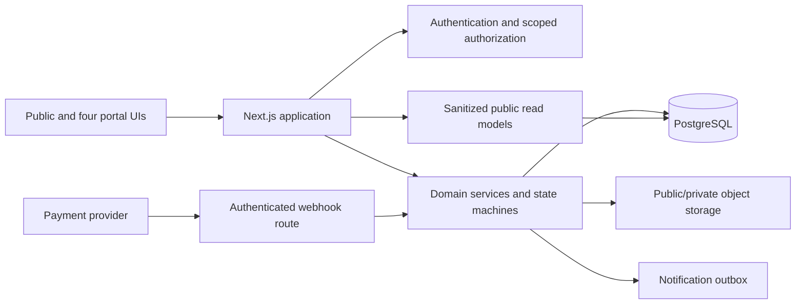
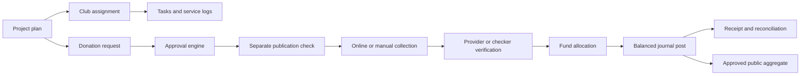

# Trustfolio expansion architecture

Status: **Phase 1 draft foundation and Phase 2–5 operational modules implemented locally; later modules are proposed**. Updated: 2026-10-26. This document does not authorize financial/public-release policy activation, deployment, or payment collection.

## Purpose and traceability

Phase 3 implementation boundary: volunteer records extend existing `User` and `ClubMembership`; there is no second account or project system. A private `VolunteerProfile` stores consent, skills, interests and opt-in coordinator sharing. Weekly availability, club attendance and integer-minute service logs are separate child records. A volunteer can submit only against an active approved club membership; a trust admin independently reviews attendance before service hours may be submitted, then reviews the hours. Approved totals require both records to remain approved. Corrections void the approved claim and preserve immutable review history; project/task attribution and certificates await later phases. The `/volunteer` and `/admin/volunteers` routes stay outside public locale routing and carry `noindex`; public DTOs do not read volunteer tables. Phase 1 financial/public-release approvals remain inactive.

Phase 4 approved design boundary: extend the existing `Project` with separate operational status, schedule, owner/manager and non-monetary planning notes. Only trust admins grant project-club assignments and select assignment coordinators. Club/project membership is checked again for each operational read or mutation. Volunteer task progress is scoped to an explicit task assignment; trust admins review completion. Milestones, dependencies, activity history and private task evidence do not enter existing public project DTOs. Existing `Project.phase`, `ContentStatus`, slug, public dates and publication/cache behavior remain the public content path. Monetary budgets, public operational/completion reports and finance posting remain future decisions.

Phase 5 architecture boundary: a private `DonationRequest` belongs to the existing `Project`; its target is positive integer INR paise. At most one linked `DonationCampaign` draft may be prepared for the request, but the record remains a private proposal until request approval and a separate publication review are authorized. Only legacy trust `ADMIN` creates/edits drafts. Request approval and campaign publication are separate state transitions. The Phase 1 approval engine is still disabled for live decisions, so protected transitions fail closed. Private supporting files use a dedicated namespace and fresh scope checks; they are excluded from legacy media pickers and all public DTOs.

Phase 6 implemented boundary: `DonorProfile`, `Donation`, append-only `DonationHistory` and private `DonationEvidence` now support ADMIN-linked existing portal accounts and offline intake. Intake rows are INR paise and DB-constrained to `PENDING_VERIFICATION`; they do not affect balances or public totals. `/donor` selects by current user ID and returns only that donor's pending records. A provider interface and test HMAC mock exist, but no real provider, checkout, persisted webhook, verification, receipt, refund, campaign publication or ledger posting is enabled. The account/currency choices are restrictions for this slice, not approved legal/accounting policy.

Extend the existing English/Tamil transparency site into trust, club, volunteer, project, fundraising, donation, and finance operations. Preserve the existing `Project`, public routes, content publication state, translations, evidence links, and admin content editor. The functional requirements are in `../requirements/trustfolio-frd.md` (`FR-*`); test scenarios are in `../testing/test.md` (`T-*`). Open business decisions `D-01` through `D-06` are recorded below and in the roadmap.

## Verified starting point

- Next.js 16.3.7 App Router, React 19.2.8, TypeScript, Tailwind CSS 4.3.3, PostgreSQL, Prisma 7.10.0, Auth.js 5 beta.32, and Zod 4.6.5 were found in the installed packages. The existing app uses `src/proxy.ts`, Server Actions, Route Handlers, and the previous Next.js caching model (`unstable_cache`). Read the installed guides before changing framework code.
- Public pages live under `src/app/[locale]`; content queries and DTOs are in `src/server/queries/public`. The admin is under `src/app/admin`; content resources are declared in `src/lib/admin-resources.ts`.
- At the initial audit, `User.role` permitted one `ADMIN` or `EDITOR` role. Phase 2 added `PORTAL_USER` without granting admin content access. `Project.phase` is a public project phase; `Project.status` is content publication. Neither expresses the proposed operational workflow.
- The initial migrations were `20260930085332_init` and `20260930103253_demo_flags`. Additive Phase 1–6 migrations cover approvals, clubs, volunteers, project operations, private fundraising drafts and pending donation intake. No ledger or live payment flow exists.
- Static audit findings: media deletion can orphan published documents; published verification can include inaccessible document evidence; verification coverage can count rows with no usable evidence; demo detection omits visible content types. See the detailed source-level findings below and `APPLICATION_CONTEXT.md`. Runtime and production-data verification remain open.

### Existing-app safeguard audit — static source review, 2026-10-26

| Safeguard | Source finding | Recommended correction for approval |
| --- | --- | --- |
| Published media/document integrity | `src/server/actions/admin/media.ts` deletes the `Media` row and file without checking published dependents. `Document.file` and verification document relations use `onDelete: SetNull` in `prisma/schema.prisma`, so a published record can remain while its source file disappears. Public document queries can then return the record with a null file, and evidence coverage still counts the published document. | Block deletion while a published public record depends on the file; require replacement or explicit unpublication first. Do not silently unpublish dependent records. |
| Published verification evidence | `verificationSchema` checks only that a published row has a document ID or external URL. `saveVerificationRecord` does not verify the linked document's publication, visibility, redaction, or public file. Bulk publication uses the same existence-only guard (`src/server/actions/admin/bulk.ts`). `toVerification` hides an unusable document but still returns the published verification row; `getEvidenceCoverage` counts every published verification row by area. | Apply one server-side eligibility rule in direct and bulk publication; count only records whose evidence meets the existing public eligibility rules. A public external source remains an allowed evidence path. |
| Demo notice and noindex coverage | `getDemoStatus` in `src/server/queries/public/trust.ts` counts selected published demo types, but omits public-facing demo-bearing `SiteSetting`, `TrustObjective`, `HistoryEvent`, `AnnualReport`, `Certificate`, `VerificationRecord`, `Story`, and `Faq` rows. Visible `SocialLink` rows are covered by the existing trust tag but are not counted independently. Public media with `isDemo` can also be attached to otherwise non-demo records without being counted. Its cache tags omit the corresponding settings, objectives, history, reports, certificates, stories, verification, FAQ, and media tags. A site with only omitted demo content may not activate the demo notice/noindex behavior. | Derive detection from the public projections, include their demo-bearing content and referenced public media, and invalidate the detector for every model that can change its result. |
| Existing project publication/cache path | `saveProject` invalidates the project, activity, and document tags; `getProjectBySlug` uses those tags and the related public-content tags. Bulk project publication also invalidates project/activity tags. No mismatch was found in this static trace. | Preserve this path and run the existing published-project regression when making approved safeguards changes. |
| Private media and donor scope | Local private files use `private-uploads`, separate from the `/uploads` public root (`src/lib/storage.ts`). Dedicated donation-evidence routes require trust-admin authorization and return `private, no-store`; `/donor` looks up the donor profile by the current user's ID. No public private-file or cross-donor path was found in the inspected source. | Preserve the namespace separation and run direct unauthenticated, editor, and cross-donor route checks. |

Scope limit: this was repository source review only. It did not enumerate deployed/database rows, inspect production storage objects, or execute browser/HTTP authorization tests. No behavior or data was changed. The three recommended corrections remain unimplemented pending explicit approval, as required by the expansion safeguard gate.

## Application boundaries

Keep one deployable application and database. Domain services own transitions; route handlers and server actions are adapters. Use database transactions for authorization-dependent financial transitions and posting. Use a durable outbox for email/notifications after commit; sending a message must never determine whether a journal posted. Provider network calls occur outside database transactions, with idempotency keys and state reconciliation.

| Boundary | Responsibility | Entry points and data rule |
| --- | --- | --- |
| Identity/authorization | Session, multi-role grants, resource scope, consent | Re-read current user and grants server-side; the proxy is navigation help only. |
| Clubs/volunteers | Membership, coordinator scope, attendance and service history | Membership alone does not grant every project of a club. |
| Projects/tasks | Extend `Project`, operational planning, assignment, task review | Public `Project.status` remains separate from operational status. |
| Fundraising | Request, policy approval, campaign publication | An approved request is not automatically public. |
| Donations/payments | Existing-account donor view; private pending cash/bank/UPI intake and evidence; test-only provider contract | Pending/unverified money is excluded from confirmed totals and books; provider-specific actions fail closed. |
| Finance | Funds, accounts, periods, budgets, expenses, ledger, reconciliation | Only the posting service writes posted journals; posted lines are immutable. |
| Transparency | Publication eligibility, bilingual read models, evidence | Public queries expose approved aggregates and public files only. |
| Notifications/audit | Durable delivery attempts and immutable decisions/events | Financial audit writes commit with the business event. |

## Routes and portal design

Preserve `/en/*`, `/ta/*`, and `/admin/*`. Proposed portals: `/club/*`, `/volunteer/*`, `/donor/*`. A multi-role account sees a portal switcher, but the selected portal is never an authorization grant. Each read and action checks permission and a club/project/record scope. Admin content editing remains available to its current roles while new operational grants are introduced additively. Portal route names and navigation labels are design proposals, not implemented paths.

## Core workflows

The approval engine owns a versioned policy snapshot and immutable decisions. It returns a domain authorization outcome; the owning module executes its own guarded transition. Do not use approval status alone as proof of publication, payment, or journal posting.

Target lifecycle: provider order creation produces `PENDING`; signed webhook/status verification produces a verified payment event; an idempotent transaction confirms the donation, allocates its fund, posts journal lines, and creates a receipt eligibility record. Manual collection follows entry, distinct authorization/verification, reconciliation where applicable, then the same posting contract. Failure, dispute, and refund transitions retain history and use reversals or new postings. Current Phase 6 stops at private offline intake and a provider test contract; no order/webhook/status or posting path is live.

## Data, caching, and integration

- Canonical write models are in PostgreSQL. Additive Prisma migrations retain current IDs/slugs and public relationships. Use `Decimal` or integer minor units for money; never `Float`. Currency and precision policy require `D-01`.
- Operational and private queries are uncached and always scoped. Public projections can use tagged cache entries; every mutation affecting a projection must invalidate its tags. No donor, approval, or raw ledger data enters a shared public cache.
- `Media` is the existing upload catalog. Add attachment ownership and access classification for new modules, rather than assuming an admin-uploaded public file is safe for any portal. Public releases use redacted, approved derivatives.
- A payment adapter exposes order creation, authenticated event parsing, payment-status lookup, refunds when supported, and settlement import. Provider IDs and webhook event IDs are unique. The provider choice remains `D-04`.
- The existing contact email helper is a delivery adapter. Operational notifications need persisted recipient, template/locale, delivery state, retries, and preference checks. Financial mutations are never retried merely because notification delivery failed.
- CSV/Excel/PDF exports are generated from permission-filtered read models with an export audit event. Formats and retention are specified per report before implementation.

## Architecture trade-offs

| Choice | Benefit | Cost/control |
| --- | --- | --- |
| Extend one Next.js app | Reuses routes, identity, localization, storage, deployment | Requires disciplined domain boundaries and separate private/public query modules. |
| Additive relational joins | Preserves history and supports many-to-many scope | More explicit status, validity, and indexes. |
| Configured, versioned approvals | Policies can change without rewriting history | Requires policy administration and migration review. Thresholds remain `D-03`. |
| One provider adapter first | Limits payment/reconciliation risk | Additional providers wait for individual certification (`D-04`). |
| Public aggregate projections | Simple privacy boundary and cache policy | Less granular transparency until disclosure policy (`D-06`) is approved. |

## Security, release, and recovery boundaries

Use server-side authentication, resource authorization, input validation, origin/CSRF controls, scoped files, rate limits, provider signatures, webhook replay protection, transactional posting, and safe errors. Separate create/verify/approve/post/reconcile permissions. New financial records are append-only after posting. Introduce structured event codes and correlation IDs; do not log secrets or private donor fields. Backup PostgreSQL and private files together and rehearse restoration before launch. Deployment and retention details need environment review.

Each phase uses an additive migration, data backfill where needed, read-path comparison, feature flag, and acceptance tests before enablement. Disable a new route/feature on rollback; posted finance data is corrected with reversals, never database reset. Destructive migrations need explicit approval.

## Open business decisions

| ID | Required decision | Consequence if open |
| --- | --- | --- |
| D-01 | Jurisdiction, currency, fiscal year, accounting basis, statutory/receipt policy | Ledger/reporting contract and live collections cannot be approved. |
| D-02 | Fund restriction, transfers, shared costs, refund allocation | Fund availability and expense rules remain provisional. |
| D-03 | **Partially resolved:** draft engine, proposed group catalog, mandatory no-self-approval, fail-closed behavior, and disabled delegation confirmed. Actual group assignments, monetary thresholds, delegation authority and policy activation remain open. | Financial and public-release approvals cannot go live. |
| D-04 | Provider, settlement account, methods, fees, recurring/refund/dispute scope | Provider-neutral test contract exists. Checkout, webhook persistence, settlement and live payment behavior remain blocked. |
| D-05 | **Resolved for clubs and Phase 3 volunteers:** existing accounts only, adult self-attestation and explicit consent, trust-admin membership/attendance/hour approval, coordinator appointment after approved membership. For the Phase 6 slice, donor profiles can link only existing `PORTAL_USER` accounts; final self-registration/guest, age and donor-consent policy remain open. | Donor portal remains linked-account-only; no public donor account creation or guest flow. |
| D-06 | Public financial disclosure level, approver and cadence | Public financial pages stay unpublished. |

No open decision is silently resolved by a proposed technical default.
