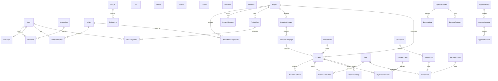

# Trustfolio expansion data model and ERD

Status: **proposed full logical model; Phase 1 through Phase 6 migrations applied locally**. Updated: 2026-10-26. This is an additive design against `prisma/schema.prisma`, not an instruction to create every table at once. `FR-*` IDs refer to `../requirements/trustfolio-frd.md`; financial details await `D-01`/`D-02`.

The actual Phase 1 physical model uses `AccessGroup`, `Permission`, `AccessGroupPermission`, `AccessGroupMembership`, `ApprovalPolicy`, `ApprovalInstance`, `ApprovalDecision`, `ApprovalDelegation`, `AuditEvent` and `NotificationOutbox`. The migration in `prisma/migrations/20261025000000_phase1_approval_foundation` creates these additively and inserts only eight proposed group catalog entries. It creates no active group membership, delegation or approval policy. The ERD below remains the **target expansion model**, including future `AccessRole`/`UserRole`/`UserScope` concepts; these are not Phase 1 tables. `AccessGroupMembership` is the current draft mechanism for group and resource scope. Preserve `User.role` for existing content permissions.

The actual Phase 2 physical model adds `PORTAL_USER` to the legacy `Role` enum and creates `Club`, `ClubMembership`, `ClubMembershipHistory` and `ClubDocument`. `Club.code` and `(clubId,userId)` are unique; all club/member/document FKs restrict deletion. A membership can be active only with adult attestation, consent version/time and join time. Membership history is append-only. `Club.status` is operational; `publicationStatus` stays `DRAFT` with no public club query. `Club.coordinatorId` is a single assigned coordinator; server checks additionally require that person's active approved membership with role `COORDINATOR` and an active club. Club documents use dedicated private uploads and a scoped read route. The migration inserts no clubs, memberships or portal users.

The Phase 3 physical model adds `VolunteerProfile` (unique `userId`, consent/adult timestamps, version and private skill-sharing flag), `VolunteerAvailability` (profile FK and bounded weekday/minute window), `VolunteerAttendance` (profile/club FKs, date, status, version, reviewer), `VolunteerServiceLog` (unique attendance FK, integer minutes, reviewer) and append-only history for both reviewed record types. All FKs restrict deletion. An expression partial unique index prevents a second SUBMITTED/APPROVED claim for the same person, club, day and case-insensitive activity title; rejected/voided claims remain historical and may be corrected with a new claim. Service minutes are constrained to 1–1440; availability windows and reviewer fields have database checks. No project/task FK is added before Phase 4. The migration creates no profiles or participation rows. Rollback disables new portals/actions but keeps audit and historical rows; no destructive down migration is proposed.

The Phase 4 physical model extends the **same** `Project` row with private operational fields and default `DRAFT` operational status; its public status, phase, slug, dates and relationships are untouched. `ProjectClubAssignment` has a unique `(projectId,clubId)` pair, scoped coordinator, version, responsibilities and view/report flags. `ProjectClubAssignmentHistory` and `ProjectClubActivity` are append-only. `ProjectMilestone` and `ProjectTask` belong to the project; tasks link one club assignment, optional milestone and parent. `TaskAssignment` uniquely links a task and volunteer profile. `ProjectTaskDependency` stores task/predecessor pairs; the service enforces same project and acyclic edges. `ProjectTaskHistory` is append-only. `ProjectTaskEvidence` restricts deletion of its private `Media`. Foreign keys restrict deletion; indexes cover project, club, assignee and status queries. Database checks enforce schedule, task progress and submitted/approved state, approval time, no self-dependency and assignment end state. No rows are backfilled and no monetary amount is introduced. Rollback disables operational routes/actions and retains historical records.

The Phase 5 physical model adds `DonationRequest` (existing Project FK, creator, positive INR `targetPaise` BIGINT, optional draft deadline, status/version and inactive approval FK), `DonationRequestHistory` and `DonationRequestEvidence` (dedicated private Media FK), plus one-to-one `DonationCampaign` (unique request FK and slug, bilingual copy, optional planning dates, operational and publication status/version, inactive release-approval FK) and `DonationCampaignHistory`. All FKs restrict deletion. The migration checks positive paise, nonnegative versions, date order, draft-only request/campaign states, null approval/publication fields and monotonic history versions; history triggers reject UPDATE/DELETE. Evidence Media cannot be deleted while linked. A later reviewed migration is required to open submission or publication states. Rollback disables new routes/actions and retains history and files.

The Phase 6 physical model adds `DonorProfile` (required unique FK to an existing `PORTAL_USER`, individual/organization type, anonymous-by-default flag), `Donation` (donor, existing published non-demo Project, optional campaign, positive integer INR paise, offline method and received date), append-only `DonationHistory`, and `DonationEvidence` linked to private `Media`. `Donation.status` has only `PENDING_VERIFICATION`; DB check/trigger rejects any other status/currency and positive-amount violations. FKs restrict deletion; evidence is served only by a fresh ADMIN check and dedicated private namespace. There are no payment-intent/webhook/receipt/allocation/ledger models in this migration. No donor data is backfilled. Current account/currency limits are implementation boundaries, not final D-01/D-05 policies.

## Existing data to retain

Keep `User`, `Project`, `Activity`, `Document`, `Media`, `VerificationRecord`, `AnnualReport`, `ImpactMetric`, other public-content models, IDs and slugs. `Project.phase` and `Project.status` retain their current meanings. Current `Role` is a Prisma enum (`ADMIN`, `EDITOR`, `PORTAL_USER`), so a future role table should be named `AccessRole` until an approved migration retires or renames the enum. Existing `ActivityLog` is a content activity log, not the new immutable financial audit store.

## Proposed entity map

`PK` is a stable CUID/UUID unless an existing PK is retained; `FK` columns named below are required unless marked optional. All mutable operational rows have `createdAt`, `updatedAt`, `createdById`, and a version counter where concurrent transitions matter. Histories have event time and actor. “Restrict” means do not cascade-delete referenced history.

| Logical entity | Implementation and key relationships | Main unique/index and deletion rule | Requirement |
| --- | --- | --- | --- |
| `User` | **Extend existing** with account state and optional verified contact fields; retain ID/email/password. | Existing unique email; do not delete a user with financial history; deactivate/anonymize subject to retention policy. | FR-IDN-01/02 |
| `AccessRole`, `Permission`, `UserRole`, `UserScope` | **New** role-permission and user-role joins; scope row targets global/club/project/own-record via explicit type/id and validity dates. | Unique role key, permission key, active role grant; index `(userId, scopeType, scopeId, expiresAt)`. Restrict referenced grants; revoke with end date. | FR-IDN-01 |
| `Club` | **Phase 2** code, bilingual private profile, coordinator FK to User, operational status, separate draft publication status. Public slug is a later publication design. | Unique immutable code; index status/coordinator. Archive, never cascade work history. | FR-CLB-01 |
| `ClubMembership`, `ClubMembershipHistory` | **Phase 2** club/user FKs, role, status, adult/consent record and append-only decision actor/reason history. | One current row per `(clubId,userId)`, including after ending; re-request updates it with history. Index user/status. Restrict history. | FR-CLB-02 |
| `ClubDocument` | **Phase 2** club/media/creator FKs, bilingual title and archive time. Media is a dedicated private club upload. | Unique club/media pair; restrict referenced rows and scope file reads by active coordinator. | FR-CLB-01/FR-PUB-02 |
| `VolunteerProfile`, `VolunteerAvailability` | **Phase 3** unique User profile with consent/adult declaration, private skills/interests and opt-in scoped sharing; weekday/minute/timezone child. | Unique user FK, unique slot, valid window check; restrict participation history. | FR-VOL-01 |
| `VolunteerAttendance`, `VolunteerServiceLog`, `VolunteerAttendanceHistory`, `VolunteerServiceLogHistory` | **Phase 3** private club activity attendance and one integer-minute service log per approved attendance; reviewer, version, immutable decision snapshot. Project/task FK is a Phase 4 extension. | Partial unique open attendance event; unique attendance/log FK; index profile/status/date; reviewed state checks; no hard deletion. | FR-VOL-02 |
| `Project` | **Extend existing** with owner/manager FKs, operational status/version, completion/review fields. Preserve existing phase/publication. | Existing unique slug; index `(operationalStatus, managerId)`. No cascade to financial children. | FR-PRJ-01/02 |
| `ProjectClubAssignment` | **Phase 4** Project/Club/coordinator FKs, responsibility, date, permissions, status, contribution history. | Unique project/club pair; index club/status and coordinator/status; restrict historic references. | FR-CLB-03 |
| `ProjectMilestone`, `ProjectTask`, `TaskAssignment`, `ProjectTaskDependency`, `ProjectTaskHistory`, `ProjectTaskEvidence` | **Phase 4** Project FK, required club assignment, optional parent/milestone, due dates, status/version; volunteer profile assignment, dependency edge, append-only history and private evidence. | Unique task/profile pair; service-level cycle check; index assignment/status/due and profile/active; restrict reviewed work. | FR-TSK-01/02 |
| `DonationRequest`, `DonationRequestHistory`, `DonationRequestEvidence` | **Phase 5** existing Project/creator FKs, integer INR paise target, bilingual purpose/justification, private evidence, draft status/version and immutable history. Approval FK stays null. | Multiple requests per project; positive paise; indexed project/status/date; private Media FK restricts deletion; draft-only SQL gate. | FR-FND-01 |
| `DonationCampaign`, `DonationCampaignHistory` | **Phase 5** one private planning draft per request, bilingual copy, planning dates, separate operational/publication status and immutable history. Target derives from its request. | Unique request FK and slug; indexed status/dates; draft-only SQL gate. Public release requires a future approved migration/policy. | FR-FND-02 |
| `DonorProfile` | **Phase 6** required unique User FK, individual/organization, anonymous-by-default; created by trust ADMIN. No self/guest registration in this slice. | Unique user FK; linked user deletion restricted; index creation. | FR-DON-01; D-05 open for final onboarding policy |
| `Donation`, `DonationHistory`, `DonationEvidence` | **Phase 6 gated slice** offline intake only; required donor and published non-demo project, optional campaign, integer INR paise, CASH/BANK_TRANSFER/UPI and pending-only status; evidence references private Media. | Unique intake idempotency key plus payload fingerprint; positive amount and INR/pending DB gates; history append-only; deletion restricted; private storage prefix and ADMIN-only read. No allocations or confirmed source keys yet. | FR-DON-01/03 |
| `DonationAllocation` | **Future Phase 7** allocation to Fund and optional project/campaign dimension after D-02. | Allocations reconcile to confirmed net gifts and posted journal source. | FR-DON-02/03; D-02 |
| `PaymentIntent`, `PaymentTransaction`, `PaymentWebhookEvent` | **Future Phase 6 after D-04** provider/order/payment IDs, expected amount, attempts, status, signed-event digest and processing outcome. Provider contract and test-only mock exist in code; no persistence or route. | Unique `(provider,orderId)`, `(provider,paymentId)`, `(provider,eventId)`; index processing status/date. Retain event history. | FR-DON-02/04/05; D-04 |
| `DonationReceipt` | **Future Phase 6/7 after D-01** donation FK, unique policy-defined receipt number, issue/version/void status and immutable snapshot. | Unique receipt number and policy-constrained donation/version; void, never delete. | FR-DON-01; D-01 |
| `Fund` | **New** type, restrictions, project/campaign optional scope, dates/status. Balance is derived from posted journals, not editable. | Unique fund code; index type/project/campaign/status. Restrict financial rows. | FR-FIN-01/02 |
| `LedgerAccount` | **New** chart account code, class, parent, status, posting eligibility. Named to avoid ambiguity with Auth.js account. | Unique account code; prevent cycles; restrict posted lines. | FR-FIN-01/03 |
| `FiscalPeriod` | **New** fiscal year, start/end, open/closed status and close actor/time. | No overlapping periods per books/currency; unique year/period code; restrict journals. | FR-FIN-01/03; D-01 |
| `Budget`, `BudgetLine` | **New** period/project/fund, version/status, category allocation, commitment and revision source. | Unique active budget scope/version; index fund/project/period. Preserve superseded revisions. | FR-FIN-04 |
| `ExpenseRequest`, `ExpenseLine`, `ExpensePayment` | **New** requester/vendor/fund/project, lines, invoices, approval reference, payment source/status. | Unique payment execution reference; index status/period/fund; restrict posted/paid history. | FR-FIN-05 |
| `JournalEntry`, `JournalLine` | **New** source type/id, posting date/period, state, reversal link; lines have account, fund, project/campaign dimensions and exact debit/credit. | Unique source posting key; indexes period/date, account/date, fund/date; posted rows immutable/restrict. | FR-FIN-03 |
| `BankReconciliation` | **New** account/period/import fingerprint, status, approved by; child statement lines and matches required. | Unique statement import fingerprint per bank account; index exceptions/status. Preserve approved imports. | FR-FIN-06 |
| `ApprovalPolicy`, `ApprovalInstance`, `ApprovalDecision` | **New** versioned rule JSON/normalized steps, subject reference, snapshot, state/version; append-only decisions. | Unique policy key/version and active subject instance; unique actor/step decision where policy requires; restrict all history. | FR-APR-01/02 |
| `NotificationOutbox`, `NotificationPreference`, `AuditEvent` | **New shared infrastructure**. Outbox delivery state/dedupe; preference per user/channel; immutable event actor/entity/correlation. | Unique outbox dedupe key; indexes recipient/status and audit entity/time. Retention controlled by policy. | FR-NTF-01, FR-AUD-01 |

The proposed subject references for approvals/audit require a database integrity design before migration: typed explicit FKs or validated binding rows are preferable to a free-form `subjectType/subjectId` alone. The phase design will select one and test orphan prevention.

## Enums and state separation

- Existing: `ContentStatus` remains `DRAFT/PUBLISHED/ARCHIVED`; `ProjectPhase` remains `PLANNED/ONGOING/COMPLETED/PAUSED` for current display behavior.
- Implemented Phase 6 intake enum: donation `PENDING_VERIFICATION` only. Proposed future states such as confirmed, failed, refund and dispute do not exist in the database and require approved posting/provider contracts. Other operational enum proposals remain as above.
- These labels are draft vocabulary. Transition maps, authority and exact terminal states are approved per phase; adding a label does not authorize a transition.

## Financial invariants and migration

Use exact decimal or integer minor-unit amounts with currency recorded on every source and journal; precision and rounding await `D-01`. A posting transaction verifies period, source uniqueness, account/fund eligibility, line count and debit/credit equality, then commits journal, source state and audit together. Posted lines cannot be updated/deleted. Corrections reference a reversal. Fund balances are derived from posted lines; no editable balance column is authoritative. Availability includes restrictions and approved commitments under a concurrency-safe lock. See `../finance/accounting-rules.md`.

Migration sequence: inventory real/demo rows and backups → add new nullable tables/fields and constraints that do not rewrite existing records → map current roles through compatibility grants → backfill only verified operational facts → compare old and new public reads → add stricter constraints after validation → enable one module at a time. Do not infer historic donations from project impact metrics or demo data. Rollback uses feature disablement and application/schema compatibility; financial correction uses reversals. Any destructive migration requires explicit approval and a restore rehearsal.
