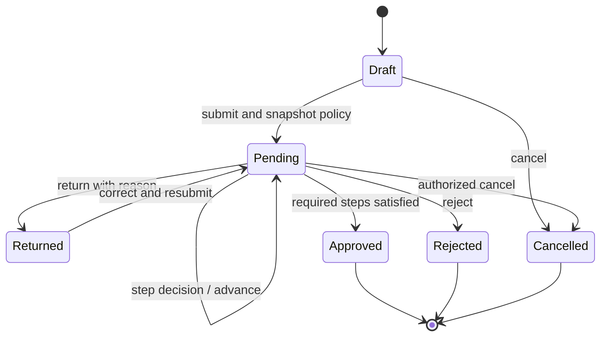

# Trustfolio approval workflows

Status: **Phase 1 draft engine, Phase 2 membership, Phase 3 volunteer reviews, Phase 5 private fundraising planning and Phase 6 pending donation intake implemented locally; financial/public-release policy activation disabled**. Updated: 2026-10-26. `D-03` confirms the draft-only approach and mandatory controls below. Actual financial/public-release approver assignments, thresholds, delegation authorization and policy activation remain open. Accounting/fund conditions are `D-01`/`D-02`.

The draft builder supports group and permission configuration, versioned policy drafts, exact decimal amount conditions, project conditions, ordered `ANY`/`ALL` steps, simulation, delegation drafts, immutable decision/audit tables and a notification outbox. A server-side gate currently rejects policy activation and live approval submission/decisions. No policy, delegation or group membership was activated by the migration. Existing content publication remains under its original behavior.

Phase 5 creates request and campaign **planning drafts** only. An ADMIN can save versioned drafts and private supporting evidence. Request submission is rejected with `APPROVAL_POLICY_INACTIVE`; campaign publication is rejected with `PUBLIC_RELEASE_INACTIVE`. SQL constraints also disallow non-draft states or non-null approval/release references. A future approved transition must validate request target/deadline/evidence, freeze its payload and policy snapshot, enforce independent maker/checker decisions, then separately review campaign disclosure and invalidate public cache on release. None of those live transitions is active here.

Phase 3 operational review: a volunteer submits attendance for an approved active club membership. A legacy trust `ADMIN` account other than that volunteer may approve or reject it. Only approved attendance can receive one service-hour claim, again reviewed by an independent trust admin. Approval uses an expected version and transaction, with a decision snapshot, actor, reason/time and outbox event. Approved minutes count only while both attendance and service log remain approved. An admin may void approved hours with a reason; voiding attendance also voids linked hours atomically. A correction is a fresh claim, preserving rejected or voided records and append-only history. This operational review does not activate Phase 1 financial/public-release policies.

## Reusable approval engine

`ApprovalPolicy` has a key, version, target kind, amount/currency and project conditions, ordered steps, `ANY` or `ALL` decision mode, mandatory no-self-approval and delegation flag. A new draft version is created for a rule change; the database prevents rewriting a saved definition. Effective dates, timeout and escalation settings remain a later design item before live activation. Never rewrite an instance's snapshot.

`ApprovalInstance` records target binding, requested action, submitter, policy snapshot/version, status, current step, version and timestamps. `ApprovalDecision` is append-only: step, eligible actor/capacity, approve/reject/return, reason/comment, delegated-from reference and time. Decisions must not contain public-facing text by default. The target module remains responsible for its own final state transition.

`Returned` resubmission, cancellation and target payload binding require a reviewed domain contract before the live gate opens. The draft engine cannot execute these transitions in production.

## Decision transaction

1. Load instance and target under a concurrency-safe transaction; compare submitted version and expected state.
2. Re-evaluate current actor identity, active grant, target scope, delegation eligibility and self-approval prohibition.
3. Check actor has not already cast a decision for the applicable step and that the instance was not cancelled or superseded.
4. Append the decision and audit event; recompute step/instance status from the policy snapshot; update using optimistic version or row lock.
5. Enqueue notification after state commit. On duplicate request with the same idempotency key, return the recorded decision. On conflicting decision, return `CONFLICT_APPROVAL_VERSION` for review.

`ANY`: one eligible approval advances the step; a rejection or return terminates the instance. `ALL`: every actor in the submitted eligible-member snapshot must approve; active membership is rechecked for every decision. Sequential steps begin only when the prior step is complete. Delegation records source, delegate, validity and scope but remains unusable for live decisions. Escalation is not implemented or authorized.

## Domain workflows

| Subject | Submit condition | Decision effect | Separate downstream gate |
| --- | --- | --- | --- |
| Club membership | Existing account, active club, adult/consent attestation and request valid. | Phase 2 trust-admin decision activates or rejects membership with immutable history; the maker cannot approve their own request. This operational decision does not activate the draft financial/public-release policy engine. | Coordinator appointment requires a separate explicit action after approval; project access still requires assignment/permission. FR-CLB-02. |
| Project-club assignment | Project and club active, responsibilities/coordinator set. | Approve activates assignment and its specific permissions. | Public project publication unchanged. FR-CLB-03. |
| Donation request | Project, purpose, amount/date and evidence complete. | Approve allows campaign draft. | Campaign copy/privacy/evidence publication review. FR-FND-01/02. |
| Campaign publication | Approved request, public documents, bilingual content and dates eligible. | Publication approver authorizes public `PUBLISHED` state. | Collection still requires live payment/finance gates. FR-FND-02. |
| Manual donation | Phase 6 currently records existing-account donor, published non-demo project, INR-paisee amount, method/date and private evidence. | Record remains `PENDING_VERIFICATION`; no checker action or verified total is available under inactive D-03. | Later checker authority, reconciliation and posting require D-01..03 and finance phase. FR-DON-03. |
| Budget/revision | Scope, period, line totals and available authority valid. | Approved version replaces prior active plan prospectively. | Spending checks still run per expense. FR-FIN-04. |
| Expense/payment | Invoice/vendor, fund/project, budget and restrictions valid. | Approval authorizes only the named stage/amount. | Payment execution, posting and reconciliation remain separate. FR-FIN-05. |
| Journal reversal/period close | Source, reason, balanced correction or close checklist present. | Checker authorizes reversal/close. | Accountant executes posting/close and records result. FR-FIN-03. |
| Reconciliation | Statement/import, matches and exceptions reviewed. | Separate reconciler approves a version. | Unresolved exceptions remain visible. FR-FIN-06. |
| Public financial release | Reconciled/approved aggregates, source/evidence and privacy preview. | Publication authority releases a snapshot. | Public cache tags invalidated; withdrawal preserves history. FR-PUB-01. |

## Policy configuration record to obtain from the trust

For each subject: actual authorized group members; amount bands and currency; project/fund conditions; ANY/ALL/sequential steps; additional maker/checker exclusions; delegation authorization, expiry and escalation; return/rejection and resubmission behavior; target payload binding; evidence needed; publication authority; emergency exception process. No self-approval is mandatory. The suggested trustee, finance and content groups in the user's decision are proposals, not authorized assignments. No amount threshold or policy is active.

## Failure and concurrency cases

Reject unauthorized scope, stale version, duplicate decision, cancelled instance, changed target amount after submission, inactive delegate, missing required group member, policy gap and conflicting approvals with stable safe codes. Any change to a submitted amount or fund creates a new approval revision; never reuse an approval of a different financial payload. Tests `T-APR-*` and finance tests in `../testing/test.md` must demonstrate these cases.
