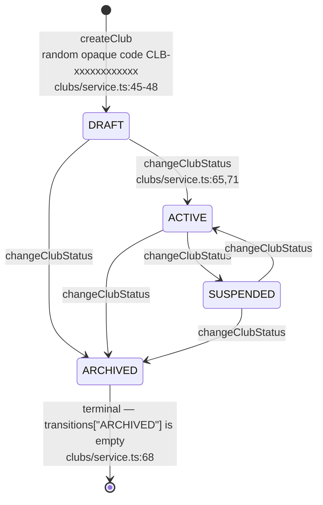
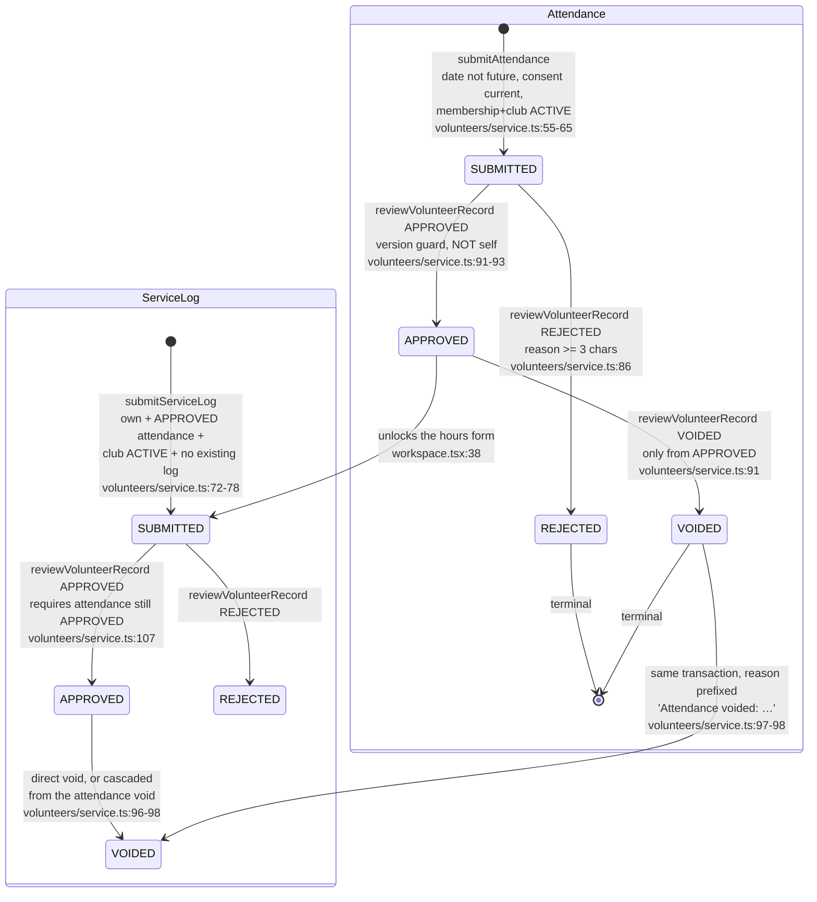
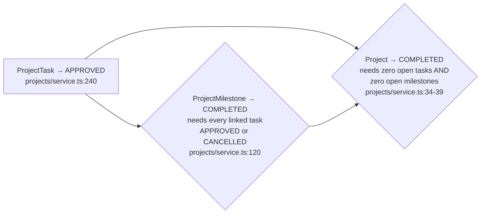
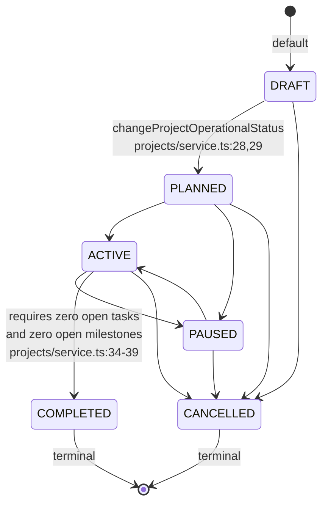
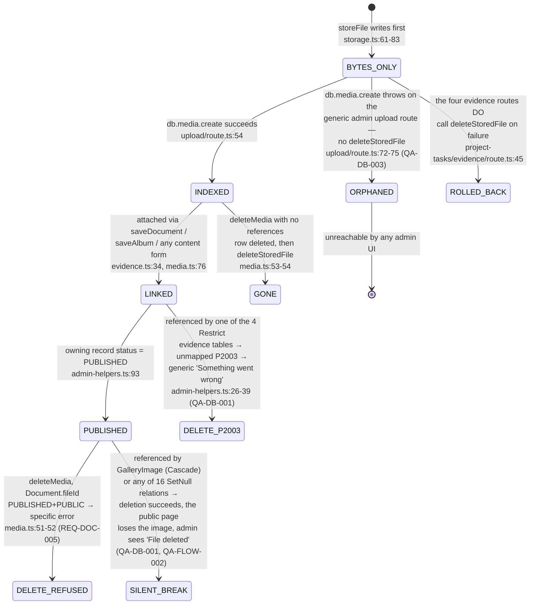

# Trustfolio — Entity State Transitions

Phase 6 output. One lifecycle per entity that the six traced workflows move through. Every arrow is
labelled with the function that performs the transition and the `file:line` where its guard lives.
States that exist in the enum but that **no code path can reach** are called out — a declared state
with no writer is a finding-shaped gap, not a feature.

Static analysis only. No transition below was executed.

---

## 1. `ClubMembership` — `ClubMembershipStatus` (`prisma/schema.prisma:202-210`)

```mermaid
stateDiagram-v2
    [*] --> REQUESTED : requestClubMembership<br/>self only, both consents, club ACTIVE<br/>clubs/service.ts:129-139
    [*] --> INVITED : inviteClubMember (ADMIN)<br/>club ACTIVE, clears consent fields<br/>clubs/service.ts:108-120
    INVITED --> REQUESTED : requestClubMembership<br/>INVITED is an allowed precursor<br/>clubs/service.ts:136
    REQUESTED --> ACTIVE : reviewClubMembership APPROVE<br/>version guard + club ACTIVE +<br/>NOT self + consent current<br/>clubs/service.ts:150-157
    REQUESTED --> REJECTED : reviewClubMembership REJECT<br/>reason required<br/>clubs/service.ts:147,156
    REJECTED --> REQUESTED : re-request allowed<br/>clubs/service.ts:136
    ENDED --> REQUESTED : re-request allowed<br/>clubs/service.ts:136
    ACTIVE --> SUSPENDED : closeClubMembership<br/>reason >= 3 chars (action-level)<br/>clubs/service.ts:189-194
    ACTIVE --> ENDED : closeClubMembership<br/>stamps endedAt; clears<br/>club.coordinatorId if the<br/>coordinator is removed<br/>clubs/service.ts:194-196
    SUSPENDED --> [*] : no transition out exists
    DRAFT --> [*] : UNREACHABLE
```



**Role is orthogonal to status.** `ClubMembershipRole` is `MEMBER` | `COORDINATOR`
(`prisma/schema.prisma:212-215`). `appointClubCoordinator` promotes only an already-`ACTIVE`
membership and demotes the previous holder to `MEMBER` in the same transaction
(`src/server/clubs/service.ts:172,177,181`). Ending the coordinator's membership nulls
`Club.coordinatorId` (`:196`), so coordinator access and membership status cannot drift apart.

**Unreachable / dead-end states:**

| State | Finding |
|---|---|
| `DRAFT` | No writer anywhere. `requestClubMembership` writes `REQUESTED`, `inviteClubMember` writes `INVITED`; grep found no `status: "DRAFT"` for this model. Dead enum member. |
| `SUSPENDED` | `closeClubMembership` can enter it, but nothing leaves it: `reviewClubMembership` only accepts `REQUESTED` (`:150`) and `closeClubMembership` only accepts `ACTIVE` (`:193`). `requestClubMembership` (`:136`) and `inviteClubMember` (`:117`) both exclude `SUSPENDED` from their allowed precursors, so a suspended member cannot be reinstated, ended, or re-request membership without direct SQL. Filed as **QA-FLOW-004**. |

**Downstream effects of `ACTIVE`** — re-checked live on every use, never cached:
attendance (`volunteers/service.ts:64`), service hours (`:77`), task assignment
(`projects/service.ts:154`), task read/write (`projects/service.ts:200,219`), coordinator scope
(`clubs/service.ts:208`, `projects/service.ts:84`).

---

## 2. `Club` — `ClubStatus` (`prisma/schema.prisma:195-200`)



The transition table is explicit and enforced before the write
(`src/server/clubs/service.ts:64-69,75`), inside a `Serializable` transaction with a version guard
(`:76`). There is **no `.delete()` on `Club` anywhere** in `src/server` or `src/app`
(`qa/architecture/database-dependency-map.md:23-26`), so this status machine is the entire lifecycle.

Documents can be attached only while the club is `DRAFT` or `ACTIVE`
(`src/server/clubs/service.ts:89`, `src/app/api/admin/clubs/[id]/documents/route.ts:24`), but the
club-document **read** route does not re-check club status — it checks coordinator scope, which
itself requires `club.status === "ACTIVE"` (`clubs/service.ts:208`), with an `ADMIN` bypass
(`src/app/api/club/documents/[id]/file/route.ts:14`).

---

## 3. `VolunteerAttendance` and `VolunteerServiceLog` — `VolunteerReviewStatus` (`prisma/schema.prisma:217-222`)



**Invariant that holds (REQ-VOL-039).** The confirmed total counts only `minutes` where the log is
`APPROVED` **and** its attendance is `APPROVED` (`src/app/volunteer/page.tsx:19`). Two independent
mechanisms protect it: the review guard at `volunteers/service.ts:107` refuses to approve hours
whose attendance is not approved, and the void cascade at `:96-98` demotes an already-approved log
when its attendance is voided. Even if the cascade were skipped, the aggregate's `attendance:
{ status: "APPROVED" }` filter would exclude the row — belt and braces.

**One-to-one constraint.** `submitServiceLog` refuses when `attendance.serviceLog` already exists
(`:75`), so a voided or rejected log cannot be replaced by a new submission for the same attendance.
Correcting a rejected log therefore requires voiding and re-submitting the **attendance**; the UI
does not say so (`src/components/volunteer/workspace.tsx:38`).

**Self-review ban.** Both branches throw `SELF_APPROVAL` (`:92`, `:106`). Reachable — see
QA-FLOW-007.

---

## 4. `ProjectTask` — `ProjectTaskStatus` (`prisma/schema.prisma:253-260`)

```mermaid
stateDiagram-v2
    [*] --> TODO : createProjectTask<br/>project PLANNED|ACTIVE, assignment ACTIVE,<br/>parent + milestone in the same project<br/>projects/service.ts:127-142
    TODO --> IN_PROGRESS : updateMyTask (volunteer, no submit)<br/>all predecessors APPROVED<br/>projects/service.ts:220-224
    IN_PROGRESS --> IN_PROGRESS : updateMyTask progress only
    TODO --> SUBMITTED : updateMyTask submit=yes<br/>progress must be exactly 100<br/>projects/service.ts:222-223
    IN_PROGRESS --> SUBMITTED : updateMyTask submit=yes
    SUBMITTED --> APPROVED : reviewTaskCompletion APPROVE<br/>NOT an assignee, predecessors APPROVED,<br/>subtasks APPROVED|CANCELLED<br/>projects/service.ts:237-240
    SUBMITTED --> IN_PROGRESS : reviewTaskCompletion RETURN<br/>reason >= 3 chars; completedAt nulled<br/>projects/service.ts:233,239-240
    TODO --> BLOCKED : setTaskAdministrativeStatus<br/>reason >= 3 chars<br/>projects/service.ts:249-255
    IN_PROGRESS --> BLOCKED : setTaskAdministrativeStatus
    SUBMITTED --> BLOCKED : setTaskAdministrativeStatus<br/>SUBMITTED is not excluded<br/>projects/service.ts:253
    BLOCKED --> IN_PROGRESS : setTaskAdministrativeStatus<br/>only BLOCKED may be resumed<br/>projects/service.ts:254
    TODO --> CANCELLED : setTaskAdministrativeStatus
    IN_PROGRESS --> CANCELLED : setTaskAdministrativeStatus
    SUBMITTED --> CANCELLED : setTaskAdministrativeStatus
    BLOCKED --> CANCELLED : setTaskAdministrativeStatus
    APPROVED --> [*] : terminal — closed at projects/service.ts:253
    CANCELLED --> [*] : terminal
```



### Evidence-acceptance window sits across this machine

`createTaskEvidenceFromUpload` accepts evidence **only** while the task is `TODO` or `IN_PROGRESS`
(`src/server/projects/service.ts:267`), and that check precedes the `ADMIN` branch at `:268`:

| Task status | Volunteer uploader | Admin uploader | Server verdict |
|---|---|---|---|
| `TODO`, `IN_PROGRESS` | shown (`task-progress.tsx:12`) | shown (`project-operations.tsx:60`) | accepted |
| `SUBMITTED` | hidden — correct | **shown** | 409 `TASK_UNAVAILABLE` → **QA-FLOW-001** |
| `BLOCKED` | hidden — correct | **shown** | 409 `TASK_UNAVAILABLE` → **QA-FLOW-001** |
| `APPROVED`, `CANCELLED` | hidden | hidden | would be rejected anyway |

Consequence: completion evidence must be attached **before** submitting, and the only way to reopen
the window is an admin `RETURN` (`projects/service.ts:239`). Nothing in either UI states the
ordering — **QA-FLOW-009**.

### `TaskAssignment` sub-lifecycle

`TaskAssignment` has no status enum; it carries `active`, `assignedAt`, `endedAt` and a unique
`(taskId, profileId)` (`src/server/projects/service.ts:155-158`). Re-assigning a previously removed
volunteer flips `active` back to `true` and clears `endedAt` (`:157`), so the row is reused rather
than duplicated. Re-asserting the same state throws `TASK_ASSIGNMENT_EXISTS` (`:156`), and removing
a volunteer who was never assigned throws `TASK_ASSIGNMENT_MISSING` (`:159`).

### Upward propagation



---

## 5. `Project` — `ProjectOperationalStatus` (`prisma/schema.prisma:224-231`)



**Operational status is independent of publication status.** `ContentStatus`
(`DRAFT`|`PUBLISHED`|`ARCHIVED`, `prisma/schema.prisma:30-34`) governs what visitors see; the action
message says so explicitly ("Operational status changed. Publication is unchanged.",
`src/server/actions/admin/project-operations.ts:47`). Donation intake keys off the **publication**
status (`PUBLISHED` and non-demo, `src/server/donations/service.ts:46`); volunteer task access keys
off the **operational** status (`ACTIVE` only, `projects/service.ts:199`). A project can therefore
accept donations while accepting no task work, and vice versa — intended, but worth a test.

**Narrower windows worth noting:** task creation needs `PLANNED`|`ACTIVE`
(`projects/service.ts:130`); coordinator scope needs `ACTIVE`|`PLANNED` (`:83`); volunteer task
access and evidence upload need `ACTIVE` exactly (`:199`, `:267`). Pausing a project silently
severs volunteer access while leaving coordinator read access intact.

---

## 6. `Media` + stored bytes — a two-store lifecycle with no shared transaction



**Reference classes on `Media` (21 inbound relations):**

| Class | Count | Example | `deleteMedia` behaviour |
|---|---|---|---|
| `Restrict` | 4 | `ClubDocument.mediaId` (`prisma/schema.prisma:403`) | DB blocks; error unmapped (QA-DB-001) |
| `Cascade` | 1 | `GalleryImage.mediaId` (`prisma/schema.prisma:1818`) | join row silently deleted (QA-DB-001) |
| `SetNull` **guarded** | 1 | `Document.fileId` when `PUBLISHED`+`PUBLIC` (`media.ts:51`) | correctly refused |
| `SetNull` **unguarded** | 15 | `Document.originalFileId`/`thumbnailId`, `Trustee.photoId`, `Project`/`Activity`/`Story`/`NewsPost`/`GalleryAlbum` covers, `Certificate.imageId`, `AnnualReport.coverId`, `Testimonial.photoId`, `HistoryEvent.imageId`, `TrustProfile.logoId`/`heroImageId`, `SiteSetting.ogImageId` (`prisma/schema.prisma:853,854,882,935,990,1071,1486,1576,1577,1621,1653,1730,1769,1802,1854`) | FK nulled silently (**QA-FLOW-002**) |

**Visibility is immutable after upload.** `mediaMetaSchema` has no `visibility` field
(`qa/architecture/database-dependency-map.md:81-86`), so a `PUBLIC` file cannot be flipped to
`PRIVATE` or back; the public gallery query re-filters `visibility: "PUBLIC"` at read time anyway.
No drift window.

---

## 7. `Document` — `ContentStatus` with publication gates

```mermaid
stateDiagram-v2
    [*] --> DRAFT : saveDocument, default status<br/>evidence.ts:34
    DRAFT --> PUBLISHED : requires a PUBLIC file in the public slot,<br/>and isRedacted when containsPersonalData<br/>validations/admin.ts:285,289
    PUBLISHED --> DRAFT : unpublish; publishedAt is RETAINED<br/>admin-helpers.ts:93-96
    PUBLISHED --> ARCHIVED : bulkAction / form<br/>bulk.ts:49-50
    DRAFT --> ARCHIVED
    ARCHIVED --> DRAFT
    ARCHIVED --> PUBLISHED : the same refines re-apply<br/>bulk.ts:49-54
```

`publishedAt` is write-once: `publishedAtFor` sets it the first time the record reaches `PUBLISHED`
and never overwrites or clears it (`src/server/actions/admin-helpers.ts:93-96`). Unpublishing
therefore preserves the original publication date — correct for an evidence-trail product, and it
means `publishedAt != null` is **not** a proxy for "currently public". Every public read must (and
does) filter on `status` as well (`src/server/queries/public/shared.ts:101`).

Bulk status changes re-apply the same publication refines (`src/server/actions/admin/bulk.ts:44-54`),
so there is no bypass through the bulk bar.

---

## 8. `Donation` — `DonationStatus` has exactly one member

```mermaid
stateDiagram-v2
    [*] --> PENDING_VERIFICATION : createPendingManualDonation<br/>status hardcoded<br/>donations/service.ts:55
    PENDING_VERIFICATION --> PENDING_VERIFICATION : evidence attached;<br/>status unchanged<br/>donations/service.ts:70-72
    PENDING_VERIFICATION --> [*] : terminal — the enum has no other member<br/>schema.prisma:65-67
```



Three independent mechanisms pin this:

1. `DonationStatus { PENDING_VERIFICATION }` — one member (`prisma/schema.prisma:65-67`).
2. A SQL `CHECK` constraint on the column
   (`prisma/migrations/20261026073000_phase6_donation_intake/migration.sql:81`), so direct SQL
   cannot invent a state either.
3. No live payment or approval path exists: `getLiveDonationProvider()` always throws
   (`src/server/payments/provider.ts:17`) and `requireLiveApprovals()` throws unconditionally
   (`src/server/fundraising/service.ts:67`) — REQ-APPR-046, inert by design.

**The donor-facing surface hardcodes the state rather than rendering it.**
`src/app/donor/page.tsx:18` prints the literal string `"Pending verification"` in the status cell
instead of `d.status`. Correct today; it will silently misreport the first time a second status
exists. Recorded in **QA-FLOW-010**.

### Adjacent lifecycles that cannot start

| Entity | Enum | Reachable states today |
|---|---|---|
| `DonationRequest` | `DRAFT`/`SUBMITTED`/`RETURNED`/`REJECTED`/`APPROVED`/`CANCELLED` (`prisma/schema.prisma:36-43`) | `DRAFT` only — REQ-FND-041, enforced by migration SQL (`qa/discovery/requirements-inventory.md:62`) |
| `DonationCampaign` | `DRAFT`/`READY`/`ACTIVE`/`PAUSED`/`CLOSED`/`CANCELLED` (`prisma/schema.prisma:45-52`) | `DRAFT` only — which is why QA-UI-004's missing campaign picker has no present impact |
| `ApprovalPolicy` | `DRAFT`/`ACTIVE`/`INACTIVE` | `DRAFT` only — `policyTransition` returns `POLICY_ACTIVATION_DISABLED` for unauthorized callers (`src/lib/approval/definition.ts:118-119`) and no caller passes `authorized: true` |

---

## 9. `NotificationOutbox` — `NotificationStatus` (`prisma/schema.prisma:183-187`)

```mermaid
stateDiagram-v2
    [*] --> PENDING : written inside the business transaction<br/>clubs/service.ts:161, volunteers/service.ts:101,112,<br/>projects/service.ts:162,244
    PENDING --> SENT : NO WRITER EXISTS
    PENDING --> FAILED : NO WRITER EXISTS
    PENDING --> [*] : rows accumulate forever; the only reader is a<br/>display list, take:10<br/>approvals/page.tsx:20
```



Writers found: club invitation and membership decision (`clubs/service.ts:123,161`), volunteer
attendance and hours decisions (`volunteers/service.ts:101,112`), task assignment and task review
(`projects/service.ts:162,244`), plus the approval foundation. **No code transitions a row out of
`PENDING`** — confirmed in `qa/architecture/application-architecture.md:90-96`.

Two consequences that only appear from the workflow view:

- The **outbound** half of every review workflow is recorded but undelivered.
- The **inbound** half has no record at all: `requestClubMembership` writes no outbox row
  (`clubs/service.ts:132-143`), so even a future delivery worker would not alert an administrator
  that a membership request is waiting. Filed as **QA-FLOW-003**.

Also note that `src/lib/email.ts:16-21` fails soft and returns `false` when `RESEND_API_KEY` or
`EMAIL_FROM` are unset, so wiring a sender would also need those variables present — recorded, not
tested (values were never read).

---

## 10. Summary of dead or stranded states

| Entity | State | Status | Evidence |
|---|---|---|---|
| `ClubMembership` | `DRAFT` | **unreachable** — no writer | `prisma/schema.prisma:203`; `clubs/service.ts:120,139` write `INVITED`/`REQUESTED` only |
| `ClubMembership` | `SUSPENDED` | **stranded** — enterable, no exit | `clubs/service.ts:193` requires `ACTIVE`; `:150` requires `REQUESTED` |
| `NotificationOutbox` | `SENT`, `FAILED` | **unreachable** — no consumer | `qa/architecture/application-architecture.md:90` |
| `DonationRequest` | all but `DRAFT` | gated by design | `qa/discovery/requirements-inventory.md:62` |
| `DonationCampaign` | all but `DRAFT` | gated by design | `prisma/schema.prisma:45-52` |
| `ApprovalPolicy` | `ACTIVE`, `INACTIVE` | gated by design | `src/lib/approval/definition.ts:118-119` |
| `ProjectTaskEvidence.archivedAt` | archived | **unreachable** — read filter exists, no writer | QA-DB-004 |

The four "gated by design" rows are consistent with REQ-APPR-046 and REQ-FND-041 and are **not**
defects. The first three rows are gaps: a state the schema declares that the application cannot
produce or cannot leave.
