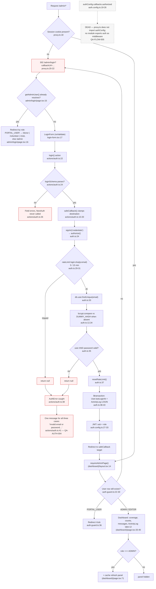
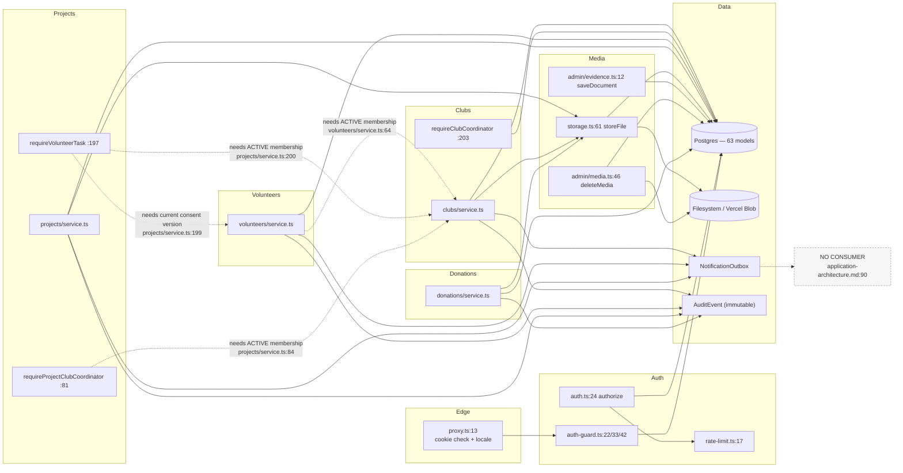

# Trustfolio — Workflow Diagrams

Phase 6 output. Mermaid flowcharts for the six traced workflows, **including failure branches**.
Every node label carries the `file:line` it was traced from. Dashed red edges are failure paths;
dotted grey nodes are gaps (something the code does not do). Nothing here is inferred from a feature
name — see `qa/workflows/user-journeys.md` for the step-by-step evidence behind each node.

Static analysis only: no diagram below was observed executing.

---

## 1. WF1 — Admin login → dashboard

**Branches an attacker or a locked-out user reaches:** `K1` and `O1` are indistinguishable at `Y`
(QA-AUTH-004); rotating source IPs resets `K` to a fresh budget of 5 (QA-AUTH-001); the IP that
keys `K` is read from the first `X-Forwarded-For` entry (`rate-limit.ts:54`, QA-AUTH-002).

---

## 2. WF2 — Club membership request → trust-admin review → active membership

```mermaid
flowchart TD
    A["Portal user opens /club<br/>club/page.tsx:14"] --> B{"getAdminUser()?"}
    B -- no --> B1["302 /admin/login?callbackUrl=/club<br/>club/page.tsx:15"]
    B -- yes --> C["ACTIVE clubs, 24/page<br/>club/page.tsx:22-26"]
    C --> D{"Existing membership?<br/>club/page.tsx:32"}
    D -- "REQUESTED / ACTIVE / SUSPENDED" --> D1["Status text only, no form"]
    D -- "none / INVITED / REJECTED / ENDED" --> E["MembershipRequest form:<br/>adult + consent, both required<br/>membership-request.tsx:15-16"]
    E --> F["requestMyClubMembership<br/>actions/club/membership.ts:11"]
    F --> G{"getAdminUser()?<br/>membership.ts:14"}
    G -- no --> G1["'Sign in before requesting membership.'"]
    G -- yes --> H{"Both consents present?<br/>membership.ts:19"}
    H -- no --> H1["'Confirm both the adult declaration…'"]
    H -- yes --> I{"rateLimit club-request 10/h<br/>membership.ts:20"}
    I -- tripped --> I1["'Too many membership requests.'"]
    I -- ok --> J["requestClubMembership<br/>clubs/service.ts:129"]
    J --> K{"actorId === userId?<br/>service.ts:130"}
    K -- no --> K1["MEMBERSHIP_SCOPE_DENIED"]
    K -- yes --> L{"Club status ACTIVE?<br/>service.ts:134"}
    L -- no --> L1["CLUB_NOT_ACTIVE"]
    L -- yes --> M{"Current status blocks?<br/>service.ts:136"}
    M -- yes --> M1["MEMBERSHIP_EXISTS"]
    M -- no --> N["Serializable tx:<br/>ClubMembership → REQUESTED<br/>+ consentAt/adultAttestedAt/consentVersion<br/>service.ts:137-139"]
    N --> O["ClubMembershipHistory (trigger-immutable)<br/>+ AuditEvent<br/>service.ts:140-141"]
    O --> P["NO NotificationOutbox row<br/>service.ts:132-143 — QA-FLOW-003"]
    P --> Q["'Request submitted. A trust administrator must approve it.'<br/>membership.ts:24"]

    Q --> R["ADMIN opens /admin/clubs/[id]<br/>requireAdminPage('ADMIN')<br/>clubs/[id]/page.tsx:11"]
    R --> R1["Loads EVERY membership + full history<br/>and EVERY User row, unbounded<br/>clubs/[id]/page.tsx:15-16 — QA-FLOW-006"]
    R1 --> S["decideMembership → requireAdmin('ADMIN')<br/>actions/admin/clubs.ts:17,83"]
    S --> T{"REJECT without reason?<br/>clubs/service.ts:147"}
    T -- yes --> T1["REASON_REQUIRED"]
    T -- no --> U{"status REQUESTED at expected version?<br/>service.ts:150"}
    U -- no --> U1["MEMBERSHIP_CONFLICT<br/>'Reload it before deciding.'"]
    U -- yes --> V{"Club still ACTIVE?<br/>service.ts:151"}
    V -- no --> V1["CLUB_NOT_ACTIVE"]
    V -- yes --> W{"actorId === membership.userId?<br/>service.ts:152"}
    W -- yes --> W1["SELF_APPROVAL<br/>'You cannot approve your own membership.'<br/>— control was rendered anyway"]
    W -- no --> X{"APPROVE and consent current?<br/>service.ts:153"}
    X -- no --> X1["CONSENT_REQUIRED"]
    X -- yes --> Y["updateMany guarded on id+version+REQUESTED<br/>→ ACTIVE (joinedAt) or REJECTED<br/>service.ts:156-157"]
    Y --> Z["History + AuditEvent + NotificationOutbox<br/>service.ts:159-161"]
    Z --> Z1["Outbox never delivered<br/>application-architecture.md:90"]
    Z --> AA["Member sees ACTIVE on /club<br/>club/page.tsx:31"]

    AA --> AB["setCoordinator → appointClubCoordinator<br/>requires ACTIVE membership<br/>clubs/service.ts:166,172"]
    AB --> AC{"requireClubCoordinator:<br/>ACTIVE + COORDINATOR + club ACTIVE<br/>+ club.coordinatorId === userId<br/>service.ts:208"}
    AC -- fail --> AC1["notFound() — 404, not 403<br/>club/[id]/page.tsx:16"]
    AC -- pass --> AD["/club/[id] workspace:<br/>roster (name+email), private docs,<br/>assigned projects<br/>club/[id]/page.tsx:20-22"]
    AD --> AE["Roster discloses every member's email<br/>— QA-REQ-006; lists unbounded — QA-API-002"]

    classDef fail fill:#fff0f0,stroke:#c00,stroke-width:1px;
    classDef gap fill:#f6f6f6,stroke:#888,stroke-dasharray:4 3;
    class B1,G1,H1,I1,K1,L1,M1,T1,U1,V1,W1,X1,AC1 fail
    class P,Z1,AE gap
```

---

## 3. WF3 — Volunteer attendance → service log → approved hours

```mermaid
flowchart TD
    A["/volunteer — getAdminUser() or redirect<br/>volunteer/page.tsx:11-12"] --> B["Profile form; consent block only when<br/>missing or stale<br/>workspace.tsx:32"]
    B --> C["saveMyVolunteerProfile → run()<br/>getAdminUser + rateLimit volunteer-write 30/h<br/>records.ts:16,18"]
    C --> D{"New profile?<br/>volunteers/service.ts:18"}
    D -- yes --> E{"consent AND adult AND version===null?<br/>service.ts:19"}
    E -- no --> E1["VOLUNTEER_CONSENT_REQUIRED"]
    E -- yes --> F["VolunteerProfile created with<br/>consentVersion/consentAt/adultAttestedAt<br/>service.ts:21"]
    D -- no --> G{"version matches?<br/>service.ts:25"}
    G -- no --> G1["VOLUNTEER_CONFLICT"]
    G -- yes --> F
    F --> H{"Any ACTIVE membership of an ACTIVE club?<br/>volunteer/page.tsx:18"}
    H -- no --> H1["'You need an approved active club membership'<br/>+ link to /club<br/>workspace.tsx:37"]
    H -- yes --> I["Attendance form<br/>workspace.tsx:37"]
    I --> J["submitMyAttendance → submitAttendance<br/>records.ts:65, service.ts:55"]
    J --> K{"serviceDate round-trips AND not future?<br/>service.ts:57"}
    K -- no --> K1["INVALID_SERVICE_DATE"]
    K -- yes --> L{"profile.consentVersion current?<br/>service.ts:63"}
    L -- no --> L1["PROFILE_REQUIRED"]
    L -- yes --> M{"membership ACTIVE AND club ACTIVE?<br/>service.ts:64"}
    M -- no --> M1["VOLUNTEER_CLUB_DENIED"]
    M -- yes --> N["VolunteerAttendance SUBMITTED<br/>+ history + audit (Serializable)<br/>service.ts:65-67"]

    N --> O["/admin/volunteers queue, 30/page<br/>requireAdminPage('ADMIN')<br/>volunteers/page.tsx:11,24"]
    O --> O1["Renders VolunteerReview for EVERY row,<br/>including the actor's own<br/>volunteers/page.tsx:33 — QA-FLOW-007"]
    O1 --> P["decideVolunteerRecord → requireAdmin('ADMIN')<br/>actions/admin/volunteers.ts:14"]
    P --> Q{"decision !== APPROVED AND reason < 3 chars?<br/>volunteers/service.ts:86"}
    Q -- yes --> Q1["REASON_REQUIRED — after a full round trip;<br/>input has no required/minLength<br/>volunteer-review.tsx:10 — QA-UI-001"]
    Q -- no --> R{"version + status guard<br/>service.ts:91"}
    R -- fail --> R1["VOLUNTEER_CONFLICT"]
    R -- pass --> S{"profile.userId === actorId?<br/>service.ts:92"}
    S -- yes --> S1["SELF_APPROVAL"]
    S -- no --> T["Attendance → APPROVED | REJECTED | VOIDED<br/>reviewedById/reviewedAt<br/>service.ts:93"]
    T --> U{"VOIDED and a service log exists?<br/>service.ts:96"}
    U -- yes --> U1["Service log → VOIDED in the same tx<br/>reason 'Attendance voided: …'<br/>service.ts:97-98"]
    U -- no --> V["History + audit + outbox<br/>service.ts:95,100,101"]
    U1 --> V
    V --> W["Outbox never sent — QA-FLOW-003"]

    T --> X{"APPROVED and no log yet?<br/>workspace.tsx:38"}
    X -- yes --> Y["Hours form appears"]
    Y --> Z["submitMyServiceLog → submitServiceLog<br/>records.ts:73, service.ts:72"]
    Z --> AA{"own + APPROVED + club ACTIVE + no log?<br/>service.ts:75"}
    AA -- no --> AA1["ATTENDANCE_REQUIRED"]
    AA -- yes --> AB{"membership still ACTIVE?<br/>service.ts:77"}
    AB -- no --> AB1["VOLUNTEER_CLUB_DENIED"]
    AB -- yes --> AC["VolunteerServiceLog SUBMITTED<br/>+ history + audit<br/>service.ts:78-80"]
    AC --> AD["Hours review: same guards<br/>+ APPROVED needs attendance APPROVED<br/>service.ts:105-107"]
    AD --> AE["Confirmed total = SUM(minutes)<br/>log APPROVED AND attendance APPROVED<br/>volunteer/page.tsx:19 — REQ-VOL-039"]

    classDef fail fill:#fff0f0,stroke:#c00,stroke-width:1px;
    classDef gap fill:#f6f6f6,stroke:#888,stroke-dasharray:4 3;
    class E1,G1,H1,K1,L1,M1,Q1,R1,S1,AA1,AB1 fail
    class O1,W gap
```

---

## 4. WF4 — Task assignment → volunteer evidence → completion review

```mermaid
flowchart TD
    A["ADMIN: /admin/project-operations/[id]<br/>tasks 25/page<br/>project-operations/[id]/page.tsx:12,22"] --> B["changeTaskVolunteer → run() → requireAdmin('ADMIN')<br/>actions/admin/project-operations.ts:16,90"]
    B --> C{"task open AND project PLANNED|ACTIVE<br/>AND assignment+club ACTIVE?<br/>projects/service.ts:151"}
    C -- no --> C1["TASK_UNAVAILABLE"]
    C -- yes --> D{"target has profile at current consent version?<br/>service.ts:153"}
    D -- no --> D1["VOLUNTEER_PROFILE_REQUIRED"]
    D -- yes --> E{"target has ACTIVE membership of that club?<br/>service.ts:154 → requireActiveMember:49"}
    E -- no --> E1["CLUB_MEMBERSHIP_REQUIRED"]
    E -- yes --> F["TaskAssignment + history + audit + outbox<br/>service.ts:155-162"]
    F --> G["revalidatePath /volunteer/tasks<br/>project-operations.ts:20"]

    G --> H["/volunteer/tasks — list query re-asserts<br/>assignment, consent, ACTIVE chain, membership<br/>volunteer/tasks/page.tsx:15"]
    H --> I{"requireVolunteerTask on detail<br/>tasks/[id]/page.tsx:15, service.ts:197-201"}
    I -- fail --> I1["notFound() — 404, not 403"]
    I -- pass --> J["TaskProgress: editable = status in TODO|IN_PROGRESS<br/>AND no open dependency<br/>task-progress.tsx:11"]
    J --> K{"editable?"}
    K -- no --> K1["Form disabled AND uploader hidden<br/>task-progress.tsx:12"]
    K -- yes --> L["TaskEvidenceUpload: fetch POST<br/>/api/project-tasks/[id]/evidence<br/>task-evidence-upload.tsx:15"]

    L --> M{"Origin host AND protocol match?<br/>evidence/route.ts:16"}
    M -- no --> M1["403 Invalid origin"]
    M -- yes --> N{"getAdminUser()?<br/>route.ts:19"}
    N -- no --> N1["401 Unauthorized"]
    N -- yes --> O{"role === ADMIN?<br/>route.ts:23"}
    O -- no --> P{"requireVolunteerTask passes?<br/>route.ts:24"}
    P -- no --> P1["404 Task not found"]
    P -- yes --> Q["rateLimit task-evidence-upload 60/h<br/>route.ts:26"]
    O -- yes --> Q
    Q -- tripped --> Q1["429"]
    Q -- ok --> R{"title 3-160 + kind valid?<br/>route.ts:30-32"}
    R -- no --> R1["400"]
    R -- yes --> S{"size / MIME / magic bytes<br/>route.ts:34-37"}
    S -- fail --> S1["413 | 415 | 415"]
    S -- pass --> T["storeFile PRIVATE 'project-task-evidence'<br/>bytes written FIRST<br/>route.ts:40, storage.ts:61-83"]
    T --> U["createTaskEvidenceFromUpload<br/>service.ts:262"]
    U --> V{"storageKey under private/project-task-evidence/?<br/>service.ts:263"}
    V -- no --> V1["PRIVATE_FILE_REQUIRED → 409"]
    V -- yes --> W{"task.status in TODO|IN_PROGRESS?<br/>service.ts:267 — applies to ADMIN too"}
    W -- no --> W1["TASK_UNAVAILABLE → 409<br/>and deleteStoredFile(route.ts:45)"]
    W -- yes --> X["tx: Media PRIVATE + ProjectTaskEvidence<br/>+ task history + audit<br/>service.ts:272-275"]
    X --> Y["201 {id}; router.refresh()"]

    Y --> Z["Volunteer sets 100% + submit<br/>updateAssignedTask, rateLimit 60/h<br/>actions/projects/tasks.ts:18,21"]
    Z --> AA{"version match?<br/>service.ts:217"}
    AA -- no --> AA1["TASK_CONFLICT"]
    AA -- yes --> AB{"scope + live membership?<br/>service.ts:218-219"}
    AB -- no --> AB1["TASK_SCOPE_DENIED"]
    AB -- yes --> AC{"status TODO|IN_PROGRESS?<br/>service.ts:220"}
    AC -- no --> AC1["TASK_STATE_DENIED<br/>'awaiting review or closed'"]
    AC -- yes --> AD{"all predecessors APPROVED?<br/>service.ts:221"}
    AD -- no --> AD1["TASK_DEPENDENCY_OPEN"]
    AD -- yes --> AE{"submit AND progress === 100?<br/>service.ts:222"}
    AE -- no --> AE1["TASK_NOT_COMPLETE"]
    AE -- yes --> AF["Task → SUBMITTED + history<br/>service.ts:224-226"]

    AF --> AG["Admin TaskRow renders review form<br/>only when status === SUBMITTED<br/>project-operations.tsx:60"]
    AG --> AGX["Evidence links sit inside a COLLAPSED details<br/>project-operations.tsx:60"]
    AF --> AH["Admin uploader still rendered because<br/>closed = APPROVED|CANCELLED only<br/>project-operations.tsx:58,60"]
    AH -.-> AH1["Always 409 on a SUBMITTED/BLOCKED task<br/>service.ts:267 — QA-FLOW-001"]
    AG --> AI["decideTask → requireAdmin('ADMIN')<br/>project-operations.ts:108,112"]
    AI --> AJ{"RETURN with reason < 3?<br/>service.ts:233"}
    AJ -- yes --> AJ1["REASON_REQUIRED — no minLength on the input<br/>QA-UI-001"]
    AJ -- no --> AK{"version AND status === SUBMITTED?<br/>service.ts:236"}
    AK -- no --> AK1["TASK_CONFLICT"]
    AK -- yes --> AL{"actor is any assignee?<br/>service.ts:237"}
    AL -- yes --> AL1["SELF_APPROVAL"]
    AL -- no --> AM{"APPROVE: predecessors APPROVED<br/>AND subtasks resolved?<br/>service.ts:238"}
    AM -- no --> AM1["TASK_WORK_OPEN"]
    AM -- yes --> AN["APPROVED + completedAt<br/>service.ts:240"]
    AJ -- "RETURN ok" --> AO["IN_PROGRESS, completedAt null<br/>service.ts:239-240"]
    AO --> AOX["Evidence window reopens — the only way back<br/>QA-FLOW-009"]
    AN --> AP["history + audit + one outbox row per assignee<br/>service.ts:242-244"]
    AP --> AQ["Unblocks dependants; permits milestone<br/>and project completion<br/>service.ts:120,36-39"]

    AR["GET /api/task-evidence/[id]/file<br/>archivedAt + PRIVATE + prefix + requireTaskReader<br/>task-evidence/file/route.ts:13-14"] --> AS["private, no-store + noindex + nosniff<br/>route.ts:17"]

    classDef fail fill:#fff0f0,stroke:#c00,stroke-width:1px;
    classDef gap fill:#f6f6f6,stroke:#888,stroke-dasharray:4 3;
    class C1,D1,E1,I1,M1,N1,P1,Q1,R1,S1,V1,W1,AA1,AB1,AC1,AD1,AE1,AJ1,AK1,AL1,AM1 fail
    class AH,AH1,AGX,AOX gap
```

---

## 5. WF5 — Upload → attach to a document → publish → (delete)

```mermaid
flowchart TD
    A["Media library / MediaPicker<br/>media-library.tsx:25, pickers.tsx:216"] --> B["POST /api/admin/upload"]
    B --> C{"Origin host matches? (host only)<br/>upload/route.ts:11-13 — QA-API-003"}
    C -- no --> C1["403 Invalid origin"]
    C -- yes --> D{"requireAdmin() → ADMIN or EDITOR<br/>route.ts:25"}
    D -- no --> D1["401 Unauthorized"]
    D -- yes --> E{"rateLimit upload 120/h<br/>route.ts:30"}
    E -- tripped --> E1["429"]
    E -- ok --> F{"size / MIME / magic bytes<br/>route.ts:43-50"}
    F -- fail --> F1["413 | 415 | 415"]
    F -- pass --> G["storeFile(file, visibility) — no namespace<br/>public/YYYY-MM/… or private/YYYY-MM/…<br/>storage.ts:61-83"]
    G --> H["db.media.create(...)<br/>route.ts:54"]
    H -- throws --> H1["500 'Upload failed' —<br/>NO deleteStoredFile; bytes orphaned forever<br/>route.ts:72-75 — QA-DB-003"]
    H -- ok --> I["ActivityLog UPLOAD + revalidateTag(media)<br/>route.ts:67-70"]
    I --> J["201 admin DTO — no storageKey<br/>admin-media.ts:23 — REQ-SEC-029"]

    J --> K["Document form: MediaPicker sets fileId /<br/>originalFileId / thumbnailId"]
    K --> L["saveDocument → adminMutation → requireAdmin()<br/>actions/admin/evidence.ts:12,16"]
    L --> M{"public slot media is PUBLIC?<br/>evidence.ts:23"}
    M -- no --> M1["fieldError fileId:<br/>'The public file must be a public upload'"]
    M -- yes --> N{"original slot media is PRIVATE?<br/>evidence.ts:26"}
    N -- no --> N1["fieldError originalFileId"]
    N -- yes --> O{"original is NOT operational-private?<br/>evidence.ts:29"}
    O -- no --> O1["'Operational files cannot be used as originals'<br/>REQ-MEDIA-007"]
    O -- yes --> P{"documentSchema refines<br/>admin.ts:285,289"}
    P -- "personal data without isRedacted" --> P1["rejected — REQ-DOC-001"]
    P -- "PUBLISHED+PUBLIC without a public file" --> P2["rejected — REQ-DOC-004"]
    P -- pass --> Q["Document created/updated;<br/>publishedAt stamped once<br/>evidence.ts:34, admin-helpers.ts:93"]
    Q --> R["ActivityLog + expire(6 cache tags)<br/>evidence.ts:35-36, admin-helpers.ts:87"]
    R --> S["Public read re-applies PUBLIC_DOCUMENT_WHERE<br/>and strips private media from DTOs<br/>queries/public/shared.ts:40,101,122"]
    S --> T["Visitor sees the published document"]
    R -.-> R1["Direct DB / seed writes bypass invalidation<br/>APPLICATION_CONTEXT.md:97"]

    U["deleteMedia<br/>actions/admin/media.ts:46"] --> V{"operational-private AND actor not ADMIN?<br/>media.ts:50"}
    V -- yes --> V1["'restricted to trust administration'"]
    V -- no --> W{"count Document{fileId, PUBLISHED, PUBLIC} > 0?<br/>media.ts:51"}
    W -- yes --> W1["Specific refusal — REQ-DOC-005<br/>(dialog copy promised otherwise — QA-UI-002)"]
    W -- no --> X["db.media.delete<br/>media.ts:53"]
    X --> Y{"Referenced by one of the 4 Restrict<br/>evidence tables?<br/>schema.prisma:403,1259,1323,1451"}
    Y -- yes --> Y1["P2003 unmapped →<br/>'Something went wrong. Please try again.'<br/>admin-helpers.ts:26-39 — QA-DB-001"]
    Y -- no --> Z{"Referenced by GalleryImage? (Cascade)<br/>schema.prisma:1818"}
    Z -- yes --> Z1["Join row cascade-deleted; photo vanishes<br/>from a PUBLISHED album; 'File deleted'<br/>QA-DB-001"]
    Z -- no --> AA{"Referenced by any of the 16 SetNull relations?<br/>Document.originalFileId/thumbnailId, Trustee.photoId,<br/>Project/Activity/Story/News/Album covers,<br/>Certificate.imageId, Report.coverId, Testimonial.photoId,<br/>HistoryEvent.imageId, TrustProfile.logo/hero, Settings.ogImage"}
    AA -- yes --> AA1["FK nulled silently; the image disappears from a<br/>live published page; admin sees 'File deleted'<br/>QA-FLOW-002"]
    AA -- no --> AB["deleteStoredFile + ActivityLog + expire<br/>media.ts:54-56"]

    classDef fail fill:#fff0f0,stroke:#c00,stroke-width:1px;
    classDef gap fill:#f6f6f6,stroke:#888,stroke-dasharray:4 3;
    class C1,D1,E1,F1,H1,M1,N1,O1,P1,P2,V1,W1,Y1 fail
    class R1,Z1,AA1 gap
```

---

## 6. WF6 — Manual donation intake → donor sees it (terminates at PENDING_VERIFICATION)

```mermaid
flowchart TD
    A["/admin/donations — requireAdminPage('ADMIN')<br/>donations/page.tsx:13"] --> B["Loads donors, PUBLISHED non-demo projects,<br/>100 recent donations; mints idempotencyKey<br/>donations/page.tsx:14-17,25"]
    B --> C["DonorLinkForm<br/>donation-intake.tsx:16"]
    C --> D["linkDonorAccount → run() → requireAdmin('ADMIN')<br/>actions/admin/donations.ts:15,34"]
    D --> E{"donorProfileSchema: ORGANIZATION needs a name<br/>validations/donations.ts:12"}
    E -- no --> E1["superRefine error — server only,<br/>no client mirror — QA-UI-003"]
    E -- yes --> F{"Account exists AND role === PORTAL_USER?<br/>donations/service.ts:20"}
    F -- no --> F1["EXISTING_PORTAL_ACCOUNT_REQUIRED"]
    F -- yes --> G["DonorProfile + AuditEvent (Serializable)<br/>service.ts:21-25"]
    G -.-> G1["anonymousByDefault never written or read;<br/>control is checked AND disabled<br/>donation-intake.tsx:26 — QA-REQ-007"]
    G -- "P2002" --> G2["'This account already has a donor profile.'<br/>actions/admin/donations.ts:25"]

    G --> H{"donors.length AND projects.length > 0?<br/>donation-intake.tsx:47"}
    H -- no --> H1["Submit silently disabled, no explanation<br/>QA-UI-005"]
    H -- yes --> I["ManualDonationIntakeForm<br/>hidden idempotencyKey, campaignId=''<br/>donation-intake.tsx:36-37 — QA-UI-004"]
    I --> J["recordManualDonationIntake → requireAdmin('ADMIN')<br/>actions/admin/donations.ts:15,41"]
    J --> K{"schema: UUID key, rupees regex > 0,<br/>receivedAt not future<br/>validations/donations.ts:4,16,22"}
    K -- fail --> K1["VALIDATION_ERROR + fieldErrors"]
    K -- pass --> L["SHA-256 requestFingerprint over the whole payload<br/>service.ts:35"]
    L --> M{"idempotencyKey already used?<br/>service.ts:36"}
    M -- "yes, same fingerprint" --> M1["Returns the EXISTING row;<br/>action still reports success<br/>service.ts:39"]
    M -- "yes, different" --> M2["IDEMPOTENCY_CONFLICT"]
    M -- no --> N{"donor still PORTAL_USER?<br/>service.ts:45"}
    N -- no --> N1["DONOR_UNAVAILABLE"]
    N -- yes --> O{"project PUBLISHED AND not demo?<br/>service.ts:46"}
    O -- no --> O1["PROJECT_UNAVAILABLE"]
    O -- yes --> P{"campaignId set AND belongs to the project?<br/>service.ts:47-49"}
    P -- no --> P1["CAMPAIGN_PROJECT_MISMATCH"]
    P -- "yes / empty" --> Q["Donation: amountPaise BigInt, INR,<br/>status PENDING_VERIFICATION hardcoded<br/>service.ts:51-56"]
    Q --> R["DonationHistory snapshot (trigger-immutable)<br/>+ AuditEvent<br/>service.ts:57-61"]
    R --> S["SQL CHECK pins positive paise, INR,<br/>PENDING_VERIFICATION<br/>phase6_donation_intake/migration.sql:81"]
    S --> T["revalidatePath /admin/donations AND /donor<br/>actions/admin/donations.ts:17-18"]
    T --> U["'Offline donation recorded as pending verification.<br/>It is excluded from confirmed totals and balances.'"]

    U --> V["Optional: POST /api/admin/donations/[id]/evidence<br/>ADMIN only, donation must be PENDING_VERIFICATION, 40/h<br/>evidence/route.ts:16,22"]
    V --> W["Media PRIVATE + DonationEvidence + audit<br/>donations/service.ts:71-73"]

    U --> X["/donor — getAdminUser() or redirect<br/>donor/page.tsx:12-13"]
    X --> Y{"DonorProfile for this user?<br/>donor/page.tsx:14"}
    Y -- no --> Y1["'Donor access is not linked.'<br/>donor/page.tsx:18"]
    Y -- yes --> Z["Table: date, project, method, formatPaise(amount),<br/>status cell = LITERAL 'Pending verification'<br/>donor/page.tsx:18"]
    Z --> AA["Banner: donations not enabled, campaigns are<br/>private drafts, no checkout/receipts/totals<br/>donor/page.tsx:17"]
    AA --> AB["Footer asserts anonymity by default —<br/>no enforcing code exists<br/>donor/page.tsx:19 — QA-FLOW-010"]

    AC["TERMINAL STATE"] --> AD["DonationStatus has exactly one member<br/>schema.prisma:65-67"]
    AD --> AE["getLiveDonationProvider() always throws<br/>payments/provider.ts:17"]
    AD --> AF["requireLiveApprovals() always throws<br/>fundraising/service.ts:67 — REQ-APPR-046"]
    Z --> AC

    classDef fail fill:#fff0f0,stroke:#c00,stroke-width:1px;
    classDef gap fill:#f6f6f6,stroke:#888,stroke-dasharray:4 3;
    class E1,F1,G2,K1,M2,N1,O1,P1,Y1 fail
    class G1,H1,M1,AB gap
```

---

## 7. Cross-module dependency map (the six workflows together)

The three dotted dependency edges into `clubs/service.ts` are the load-bearing couplings: club
membership is the single gate every other portal capability re-checks on every read and write. A
change to `ClubMembership.status` semantics therefore enters the regression set of WF2, WF3 **and**
WF4 — see `qa/architecture/dependency-matrix.md` for the per-pair failure consequences.
